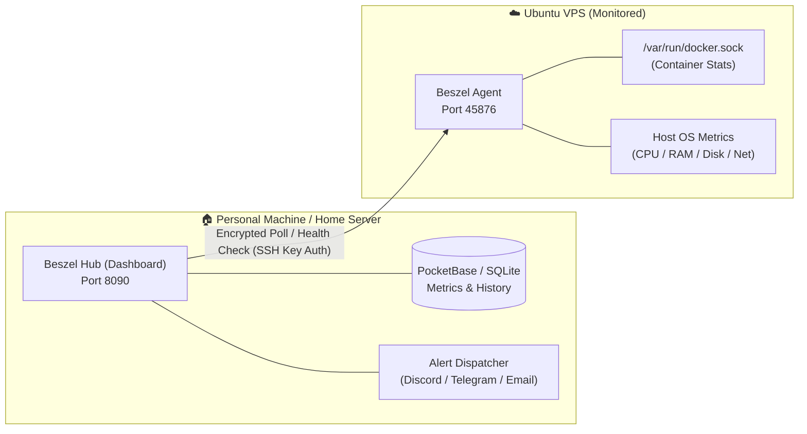
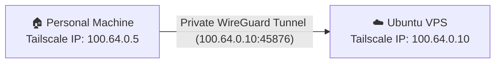

# 📊 Beszel VPS Monitoring Setup Guide

A step-by-step guide to setting up [Beszel](https://github.com/henrygd/beszel) — a lightweight, private server monitoring hub and agent. In this setup, your **personal machine** (or home server) hosts the Beszel Hub dashboard, while your **Ubuntu VPS** runs the Beszel Agent. When your VPS crashes, reboots, or goes offline, you receive instant alerts.

> Tested on **Ubuntu 22.04 LTS** and **Ubuntu 24.04 LTS** (VPS Agent), and **macOS / Linux / Windows** (Personal Machine Hub).

---

## What Is Beszel?

Beszel is a modern, lightweight, self-hosted alternative to heavy monitoring stacks like Prometheus + Grafana or Datadog. It consists of two components:

1. **Beszel Hub (Dashboard & Alert Manager)**:
   - Runs on your **personal machine** (laptop, desktop, or home server).
   - Serves a clean web UI powered by an embedded PocketBase SQLite database.
   - Polls your servers for metrics (CPU, RAM, disk, network, temperatures, and Docker containers).
   - Sends notifications (Discord, Telegram, Email, Ntfy, Pushover, Webhook) when an agent **goes down** or exceeds resource thresholds.

2. **Beszel Agent (Lightweight Exporter)**:
   - Runs on your **remote Ubuntu VPS**.
   - Uses minimal resources (< 15 MB RAM, negligible CPU).
   - Listens on port `45876` for encrypted connections from your Hub.
   - Authenticates connections using an ED25519 SSH public key generated by your Hub — no unauthorized client can query your metrics.

---

## Architecture Overview



### How the "VPS Down" Detection Works
The Beszel Hub polls the Beszel Agent on your VPS on a configurable interval (default: every 60 seconds). If your VPS crashes, loses power, kernel panics, or suffers a network blackout, the Hub fails to reach the Agent. After a missed check, the Hub immediately flags the system as **Down** and dispatches an alert to your configured channel.

> [!NOTE]
> For continuous 24/7 downtime alerts, the Hub needs to run on a machine that stays powered on and connected to the internet (such as an always-on desktop, a mini PC, a Raspberry Pi, or a home server). If running on a laptop that sleeps, uptime checks will pause while the laptop is asleep and resume when you wake it.

---

## Prerequisites

- **On your VPS:**
  - Ubuntu 22.04 or 24.04 LTS (configured per the [VPS setup guide](../README.md)).
  - A non-root sudo user (`admin`).
  - [Docker Engine & Docker Compose](../guides/docker-setup.md) installed (or root access for the binary install script).
- **On your Personal Machine:**
  - Docker Desktop / Docker Engine installed (macOS, Linux, or Windows), OR ability to run standalone binaries.
  - Web browser to access the dashboard.
- **Network connectivity:**
  - The personal machine needs network reachability to the VPS on port `45876`. This can be via your VPS's public IP or securely over a private [Tailscale network](../guides/tailscale-setup.md) (recommended).

---

## Table of Contents

1. [Install Beszel Hub on Your Personal Machine](#1-install-beszel-hub-on-your-personal-machine)
2. [Access the Dashboard & Retrieve Your Public Key](#2-access-the-dashboard--retrieve-your-public-key)
3. [Install Beszel Agent on Your Ubuntu VPS](#3-install-beszel-agent-on-your-ubuntu-vps)
   - [Method A: Docker Compose (Recommended)](#method-a-docker-compose-recommended)
   - [Method B: Native Binary via Systemd](#method-b-native-binary-via-systemd)
4. [Configure the VPS Firewall (UFW)](#4-configure-the-vps-firewall-ufw)
5. [Connect the VPS in the Hub Dashboard](#5-connect-the-vps-in-the-hub-dashboard)
6. [Configure VPS Down & Resource Alerts](#6-configure-vps-down--resource-alerts)
7. [Test the VPS Down Alert](#7-test-the-vps-down-alert)
8. [Connecting Over Tailscale (Zero Public Ports)](#8-connecting-over-tailscale-zero-public-ports)
9. [Updating Beszel](#9-updating-beszel)
10. [Troubleshooting & Maintenance](#10-troubleshooting--maintenance)

---

## 1. Install Beszel Hub on Your Personal Machine

We'll run Beszel Hub via Docker Compose on your local/personal machine.

### Step 1.1: Create a Project Directory

Open a terminal on your personal machine:

```bash
mkdir -p ~/beszel-hub && cd ~/beszel-hub
```

> Creates and enters a dedicated directory for your Beszel Hub configuration and database storage.

### Step 1.2: Create the `docker-compose.yml` File

Create `docker-compose.yml`:

```bash
nano docker-compose.yml
```

Paste the following configuration:

```yaml
services:
  beszel:
    image: henrygd/beszel:latest
    container_name: beszel-hub
    restart: unless-stopped
    ports:
      - "8090:8090"
    volumes:
      - ./beszel_data:/beszel_data
    environment:
      APP_URL: "http://localhost:8090"
```

> - `image: henrygd/beszel:latest` — Pulls the official, lightweight Beszel Hub image.
> - `container_name: beszel-hub` — Assigns a friendly name to the container.
> - `restart: unless-stopped` — Ensures the Hub restarts automatically after reboots or crashes.
> - `ports: - "8090:8090"` — Exposes the dashboard on port `8090`.
> - `volumes: - ./beszel_data:/beszel_data` — Persists the PocketBase SQLite database and encryption keys locally on your disk.
> - `APP_URL` — Base URL used for links and internal redirection.

### Step 1.3: Start the Hub Container

```bash
docker compose up -d
```

> Downloads the image and starts the Beszel Hub in the background.

Verify it is running:

```bash
docker compose ps
```

---

## 2. Access the Dashboard & Retrieve Your Public Key

### Step 2.1: Initial Admin Account Setup

1. Open your browser and navigate to:
   ```
   http://localhost:8090
   ```
2. On first launch, Beszel will ask you to create the initial admin account:
   - **Email**: Enter your personal email address.
   - **Password**: Enter a strong password (minimum 10 characters).
3. Click **Create Account** to log in to the dashboard.

### Step 2.2: Click "Add System" to View Your Hub's Public Key

In the top navigation or dashboard center:
1. Click the **Add System** button.
2. A modal dialog will appear. Look for the **Public Key** field.
3. Beszel generates a unique ED25519 public key (looks like `ssh-ed25519 AAAAC3NzaC1lZDI1NTE5...`).
4. **Copy this Public Key.** You will supply this key to the agent on your VPS so the agent only answers to your Hub.

Keep this tab open while you configure the VPS.

---

## 3. Install Beszel Agent on Your Ubuntu VPS

SSH into your remote Ubuntu VPS:

```bash
ssh admin@YOUR_VPS_IP
```

Choose either **Method A (Docker Compose)** or **Method B (Native Binary via Systemd)**.

---

### Method A: Docker Compose (Recommended)

This method isolates the agent in a container while giving it read-only access to host system stats and Docker container metrics.

#### Step 3A.1: Create Directory

```bash
mkdir -p ~/beszel-agent && cd ~/beszel-agent
```

#### Step 3A.2: Create `docker-compose.yml`

```bash
nano docker-compose.yml
```

Paste the following configuration, replacing `PASTE_YOUR_HUB_PUBLIC_KEY_HERE` with the public key copied from Step 2.2:

```yaml
services:
  beszel-agent:
    image: henrygd/beszel-agent:latest
    container_name: beszel-agent
    restart: unless-stopped
    network_mode: host
    volumes:
      - /var/run/docker.sock:/var/run/docker.sock:ro
      - ./beszel_agent_data:/var/lib/beszel-agent
    environment:
      PORT: 45876
      KEY: "PASTE_YOUR_HUB_PUBLIC_KEY_HERE"
```

> - `network_mode: host` — Grants the agent direct access to the host network interface to accurately record network throughput and listen on port `45876`.
> - `/var/run/docker.sock:/var/run/docker.sock:ro` — Read-only access to the Docker socket to display CPU/memory per running container in the dashboard.
> - `PORT: 45876` — The listening port for Beszel Hub poll requests.
> - `KEY` — The Hub's public SSH key. Connections not matching this key are immediately dropped.

#### Step 3A.3: Start the Agent

```bash
docker compose up -d
```

Verify that the agent started without errors:

```bash
docker compose logs -f
```

Press `Ctrl+C` to exit the logs.

---

### Method B: Native Binary via Systemd

If you prefer not to use Docker on your VPS, Beszel provides an official one-line installer that creates a systemd service.

Run the official installation script:

```bash
curl -sL https://raw.githubusercontent.com/henrygd/beszel/main/supplemental/scripts/install-agent.sh -o install-agent.sh
chmod +x install-agent.sh
sudo ./install-agent.sh -p 45876 -k "PASTE_YOUR_HUB_PUBLIC_KEY_HERE"
```

> - `-p 45876` — Sets the listening port.
> - `-k "..."` — Injects your Hub's public SSH key into the agent's authorized list.
> - Automatically creates a dedicated `beszel` system user and enables the `beszel-agent.service` systemd unit.

Check the service status:

```bash
sudo systemctl status beszel-agent
```

---

## 4. Configure the VPS Firewall (UFW)

Your Ubuntu VPS has UFW enabled. For the Hub on your personal machine to poll the agent, port `45876` must be accessible.

### Option 1: Allow Port 45876 (Global with Public Key Protection)

Because Beszel Agent enforces cryptographic ED25519 SSH key authentication for every connection, exposing port 45876 is secure:

```bash
sudo ufw allow 45876/tcp comment "Beszel Agent Monitoring"
sudo ufw reload
```

> - `45876/tcp` — Allows inbound TCP traffic on Beszel Agent's port.
> - `comment` — Labels the rule in `sudo ufw status numbered`.

### Option 2: Restrict to Your Home/Office Public IP (Maximum Hardening)

If your personal machine has a static public IP (or an infrequently changing dynamic IP), you can restrict access solely to your IP:

```bash
sudo ufw allow from YOUR_HOME_PUBLIC_IP to any port 45876 proto tcp comment "Beszel Agent from Home"
sudo ufw reload
```

> Replace `YOUR_HOME_PUBLIC_IP` with the public IP of your personal machine's internet connection (find it via `curl -4 ifconfig.me` on your personal machine).

Verify the rule:

```bash
sudo ufw status
```

---

## 5. Connect the VPS in the Hub Dashboard

Return to your browser on your personal machine (`http://localhost:8090`):

1. If the **Add System** modal is still open, fill in the fields:
   - **Name**: A recognizable identifier (e.g., `production-vps` or `ubuntu-vps`).
   - **Host / IP**: The public IP address of your VPS (e.g., `198.51.100.25`).
   - **Port**: `45876` (default).
2. Click **Add System** (or **Save**).

Within a few seconds, the status indicator will turn **green** (Active), and live statistics will begin streaming:
- Real-time CPU, RAM, and Disk utilization
- Network input/output traffic graphs
- Docker container breakdown with per-container CPU & RAM usage

---

## 6. Configure VPS Down & Resource Alerts

This is the core objective: receiving an alert the moment your VPS goes offline or experiences high load.

### Step 6.1: Open System Alerts

1. In the Beszel dashboard, click on your VPS system card to open its detail view.
2. Click the **Alerts** (bell icon or tab) in the upper right.

### Step 6.2: Enable the "Status / Offline" Alert

1. Toggle on **Status / Connection Alert**.
2. This monitors heartbeats. If the Hub fails to contact the VPS agent during its polling cycle, the system triggers a **System Down** state.

### Step 6.3: Configure Notification Channels

Beszel supports multiple notification channels. Click your user profile / settings in the sidebar or navigation to configure:

#### Option A: Discord Webhook
1. In your Discord server: **Channel Settings** ➔ **Integrations** ➔ **Webhooks** ➔ **New Webhook** ➔ **Copy Webhook URL**.
2. In Beszel Hub: Paste the URL into the **Discord Webhook** field.
3. Click **Test** to send a test ping to your Discord channel.

#### Option B: Telegram Bot
1. Create a bot using [@BotFather](https://t.me/botfather) and get the `Bot Token`.
2. Get your `Chat ID` from [@userinfobot](https://t.me/userinfobot).
3. In Beszel Hub: Enter the Bot Token and Chat ID.
4. Click **Test**.

#### Option C: Ntfy (Push Notifications to Phone / Desktop)
1. Install the free **ntfy** app on your phone (iOS/Android) or use `https://ntfy.sh`.
2. Subscribe to a custom topic name (e.g., `my-vps-alerts-789a`).
3. In Beszel Hub: Set URL to `https://ntfy.sh/my-vps-alerts-789a`.

#### Option D: Email (SMTP)
Configure your SMTP provider (Gmail App Password, Resend, Brevo, AWS SES) with host, port, username, and password.

### Step 6.4: Set Resource Warning Thresholds (Optional)

In the same Alerts panel, you can set proactive warnings before the VPS actually goes down:
- **CPU Usage > 90%** for more than 5 minutes
- **Memory Usage > 90%** for more than 5 minutes
- **Disk Space > 85%** (prevents out-of-disk crashes)

Save your alert configurations.

---

## 7. Test the VPS Down Alert

To verify that you will be notified when your VPS goes down in real life, perform a controlled test.

### Step 7.1: Stop the Agent on the VPS

SSH into your VPS and stop the agent:

**If using Docker:**
```bash
cd ~/beszel-agent && docker compose stop
```

**If using Systemd:**
```bash
sudo systemctl stop beszel-agent
```

### Step 7.2: Observe the Hub & Receive Alert

1. On your personal machine's Beszel dashboard, watch the system status indicator.
2. Within 1 to 2 polling intervals (~60–120 seconds), the system status will change from **Active (Green)** to **Down / Offline (Red)**.
3. Check your alert destination (Discord, Telegram, Phone, or Email). You should see an alert:
   > 🚨 **System Down**: `production-vps` is unreachable.

### Step 7.3: Restart the Agent

Bring the agent back up:

**If using Docker:**
```bash
docker compose start
```

**If using Systemd:**
```bash
sudo systemctl start beszel-agent
```

Within a minute, the dashboard will turn green, and Beszel will send a **System Restored / Up** recovery notification!

---

## 8. Connecting Over Tailscale (Zero Public Ports)

If you have already followed our [Tailscale Setup Guide](../guides/tailscale-setup.md), you can connect your Hub and Agent through your private mesh network with **no ports open to the public internet**.



### Advantages
- Port `45876` is closed to the outside world.
- Traffic is end-to-end encrypted with WireGuard.
- Dynamic IPs on home connections do not disrupt connectivity.

### Configuration Steps

1. Verify Tailscale is active on both your personal machine and VPS:
   ```bash
   tailscale status
   ```
2. On your VPS, note its Tailscale IP:
   ```bash
   tailscale ip -4
   ```
   *(Example: `100.85.12.34`)*

3. Restrict UFW on your VPS so port 45876 only accepts connections from the Tailscale interface:
   ```bash
   # Remove global rule if previously added
   sudo ufw delete allow 45876/tcp
   
   # Allow only over Tailscale interface
   sudo ufw allow in on tailscale0 to any port 45876 proto tcp comment "Beszel Agent via Tailscale"
   sudo ufw reload
   ```

4. In the Beszel Hub Dashboard (`http://localhost:8090`):
   - Edit the system settings for your VPS.
   - Change the **Host / IP** to your VPS's Tailscale IP (`100.85.12.34`).
   - Save.

The Hub now monitors your VPS securely across the private VPN tunnel.

---

## 9. Updating Beszel

### Updating Beszel Hub (Personal Machine)

```bash
cd ~/beszel-hub
docker compose pull
docker compose up -d
```

> Pulls the latest Hub image and recreates the container without losing database data.

### Updating Beszel Agent (Ubuntu VPS)

**Docker:**
```bash
cd ~/beszel-agent
docker compose pull
docker compose up -d
```

**Systemd binary installer:**
Re-running the installation script updates the binary automatically:
```bash
curl -sL https://raw.githubusercontent.com/henrygd/beszel/main/supplemental/scripts/install-agent.sh -o install-agent.sh
chmod +x install-agent.sh
sudo ./install-agent.sh -p 45876 -k "YOUR_KEY"
```

---

## 10. Troubleshooting & Maintenance

### Hub Cannot Connect ("Connection Refused" or "Timeout")

1. **Verify agent container or service is running:**
   ```bash
   # Docker
   docker ps | grep beszel
   
   # Systemd
   sudo systemctl status beszel-agent
   ```

2. **Verify port is listening:**
   ```bash
   sudo ss -tulpn | grep 45876
   ```
   You should see `LISTEN` on `0.0.0.0:45876` or `:::45876`.

3. **Check UFW firewall rules:**
   ```bash
   sudo ufw status verbose
   ```
   Ensure port 45876 is allowed.

4. **Test reachability from your personal machine:**
   In your personal machine's terminal:
   ```bash
   nc -zv YOUR_VPS_IP 45876
   ```
   Or on Windows PowerShell:
   ```powershell
   Test-NetConnection -ComputerName YOUR_VPS_IP -Port 45876
   ```
   If it outputs `Connection to YOUR_VPS_IP 45876 port [tcp/*] succeeded!`, network routing and firewall are configured correctly.

### "Permission Denied (publickey)"

- The public key on the agent does not match the key generated by the Hub.
- On the VPS, verify the `KEY` variable in `docker-compose.yml` or `/etc/systemd/system/beszel-agent.service`. Ensure there are no extra quotes or broken characters.

### Docker Container Stats Not Showing

- Ensure the Docker socket `/var/run/docker.sock` is mounted into the agent container with read permissions (`:ro`).
- Check that your non-root user or agent belongs to the `docker` group if using native binary mode:
  ```bash
  sudo usermod -aG docker beszel
  sudo systemctl restart beszel-agent
  ```

---

## 11. Final Checklist

| Component | Task | Status |
|---|---|---|
| **Hub** | Docker container running on personal machine (`:8090`) | ⬜ |
| **Hub** | Admin account created and public key copied | ⬜ |
| **VPS** | Beszel Agent running with Hub's public key configured | ⬜ |
| **VPS** | Port `45876` opened in UFW (or routed over Tailscale) | ⬜ |
| **Hub** | VPS shows green / Active in web dashboard | ⬜ |
| **Alerts** | Notification channel (Discord / Telegram / Email) verified | ⬜ |
| **Test** | Agent stopped temporarily to verify "VPS Down" alert triggers | ⬜ |
